# Module 13 Lab 2
# Digital Bookshelf API

## Reflection Questions
1. Why is it beneficial to separate your routes, models, and database connection into different directories?

Separating routes, models, and database connections into different directories makes the project easier to understand, manage, and maintain.

While working on this project, I understood that each file has a specific responsibility. The routes folder handles API requests, the models folder defines the structure of the data, and the db folder handles the database connection.

Keeping these separate avoids putting all the code into one file. It also makes it easier to find and update specific parts of the application without affecting other functionality.

2. What is the difference between PUT and PATCH HTTP methods, and which one does your PUT /:id endpoint more closely resemble?

Both PUT and PATCH are HTTP methods used to update existing resources, but they work differently.

PUT is generally used to replace an entire resource with the new data provided, whereas PATCH is used to update only specific fields without replacing the entire resource.

In my project, I used findByIdAndUpdate() in the PUT route. I tested it by changing only the inStock field while keeping the other book details unchanged.

Because my implementation allows updating individual fields, its behavior is closer to PATCH than a traditional full-resource PUT operation.

3. In the DELETE route, what is a good practice for the response you send back to the client after a successful deletion?

Should you send the deleted object, a simple success message, or something else? Why?

After successfully deleting a book, it is good practice to send a response confirming that the deletion was successful.

In my project, I return a success message along with the deleted book details and a 200 OK status code.

Including the deleted book details helps the client understand exactly which record was removed. I also added a check to see whether the book exists before attempting to delete it. If the book is not found, the API returns a 404 Not Found response with a message saying "Book not found".

This helped me understand the importance of sending meaningful responses for both successful operations and errors.

## 1. Introduction

The Digital Bookshelf API is a backend project built using Node.js, Express.js, and MongoDB. The purpose of this project is to create a REST API that allows users to manage a collection of books.

The API supports the main CRUD operations: Create, Read, Update, and Delete. Each book is stored in a MongoDB database, and the API allows clients to add new books, retrieve book information, update existing records, and delete books.

This project helped me understand how a backend application communicates with a database and how HTTP requests are handled through API endpoints.

## 2. Aim of the Project

The main aim of this project is to:

- Build a REST API using Express.js.
- Connect an Express application to MongoDB using Mongoose.
- Create a Book schema and model.
- Implement CRUD operations for managing book records.
- Handle errors and return appropriate HTTP status codes.
- Test API endpoints using Postman and verify stored data using MongoDB Compass.

## 3. Technologies and Tools Used

| Technology / Tool | Purpose |
|---|---|
| Node.js | JavaScript runtime used to execute the backend application. |
| Express.js | Used to create the server and define API routes. |
| MongoDB Atlas | Cloud database used to store book information. |
| MongoDB Compass | Used to view, search, and verify documents stored in MongoDB. |
| Mongoose | Used to define the Book schema and interact with MongoDB. |
| Postman | Used to send and test GET, POST, PUT, and DELETE requests. |
| VS Code | Code editor used for developing the project. |
| dotenv | Used to load environment variables from the `.env` file. |
| Git and GitHub | Used for version control and maintaining the project repository. |

## 4. Project Structure

```text
digital-bookshelf-api/
│
├── index.js
├── db/
│   └── connection.js
├── models/
│   └── Book.js
├── routes/
│   └── bookRoutes.js
├── .env
├── .gitignore
├── package.json
├── package-lock.json
└── REFLECTION.md
```


## 5. Book Schema

The Book model contains the following fields:

| Field | Data Type | Description |
|---|---|---|
| title | String | Book title (required). |
| author | String | Name of the author (required). |
| isbn | String | Unique ISBN number. |
| publishedDate | Date | Date the book was published. |
| inStock | Boolean | Indicates whether the book is available. Defaults to `true`. |

## 6. API Endpoints

All book-related routes use the base URL:

`http://localhost:3000/api/books`

| HTTP Method | Endpoint | Purpose |
|---|---|---|
| POST | `/api/books` | Add a new book. |
| GET | `/api/books` | Retrieve all books. |
| GET | `/api/books/:id` | Retrieve a book using its ID. |
| PUT | `/api/books/:id` | Update an existing book. |
| DELETE | `/api/books/:id` | Delete a book using its ID. |

## 7. HTTP Status Codes Used

The following HTTP status codes are used in the API responses.

| Status Code | Status | When It Is Used |
|---|---|---|
| 200 | OK | When a GET, PUT, or DELETE request is successful. |
| 201 | Created | When a new book is successfully created using POST. |
| 404 | Not Found | When a requested book ID does not exist in the database. |
| 500 | Internal Server Error | When an unexpected error occurs while processing a request. |

## 8. API Testing and Results

I tested the API using Postman and also verified the results through the browser and MongoDB Compass.

| No. | Operation | Testing Method | Expected Result | Result |
|---|---|---|---|---|
| 1 | Check server | Browser | Displays the server running message. | Passed |
| 2 | Get all books | Postman / Browser | Returns the list of books. | Passed |
| 3 | Create a book | Postman | Returns the newly created book with status 201. | Passed |
| 4 | Get book by ID | Postman / Browser | Returns the requested book. | Passed |
| 5 | Get non-existing book | Postman / Browser | Returns 404 with "Book not found". | Passed |
| 6 | Update a book | Postman | Returns the updated book with status 200. | Passed |
| 7 | Verify updated book | MongoDB Compass / Browser | Confirms that the updated information is saved and returned by the API. | Passed |
| 8 | Delete a book | Postman | Returns a successful deletion message with status 200. | Passed |
| 9 | Verify deleted book | MongoDB Compass / Browser | Confirms that the deleted book is no longer available. | Passed |
| 10 | Get deleted book by ID | Postman / Browser | Returns 404 with "Book not found". | Passed |

**Note:** Postman was used to perform the PUT and DELETE requests. The browser was used to retrieve and view the API responses, while MongoDB Compass was used to verify the actual database changes.

### Screenshots

The following screenshots can be included to demonstrate the implementation and testing results.

**1. Server and Database Connection Verification**

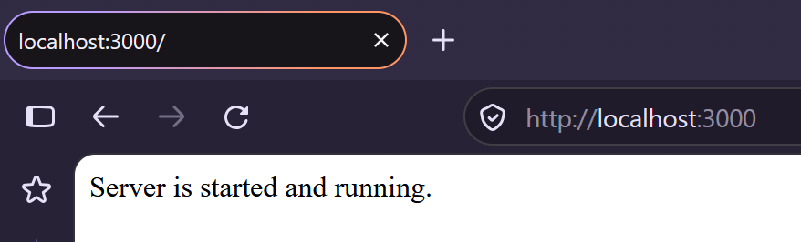

**2. Server & MongoDB Setup**

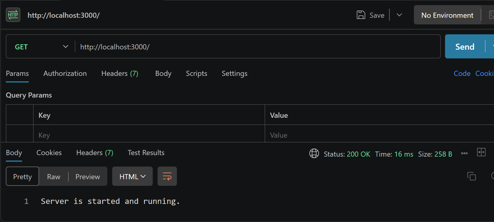

**3. Verifying the Server and Database**

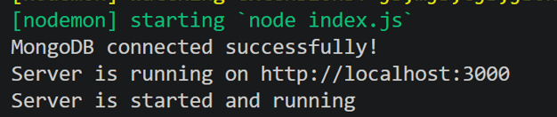

**4. Get All Books — Initial Empty State (`GET /api/books`)**

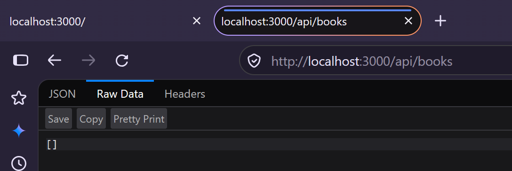

<br>

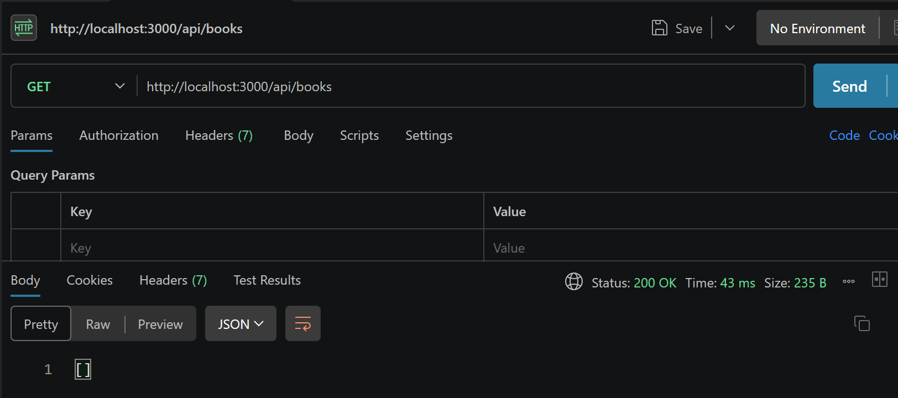

**5. Create a Book (`POST /api/books`)**

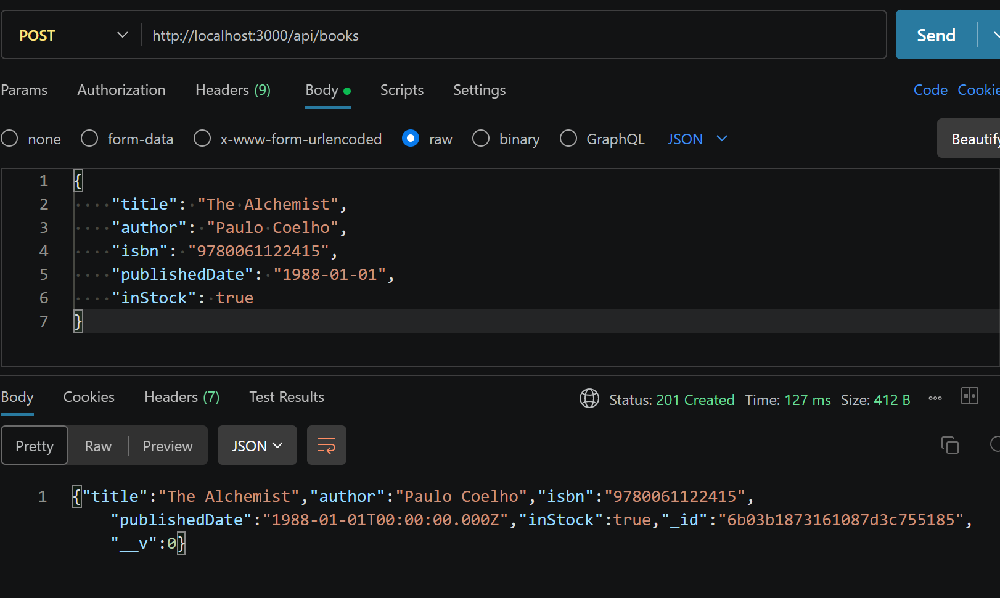

**6. Get All Books — After Adding a Book (`GET /api/books`)**

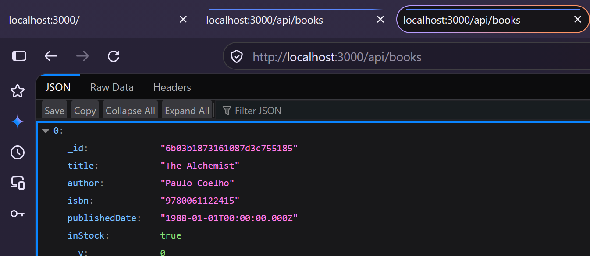

<br>

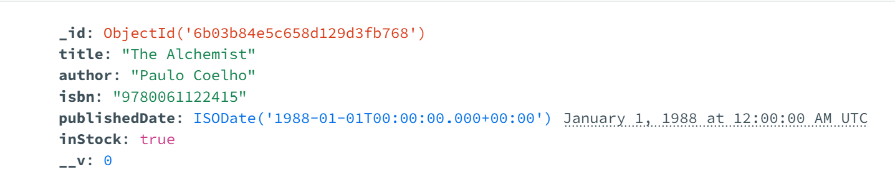

**7. Get Book by ID (`GET /api/books/:id`)**

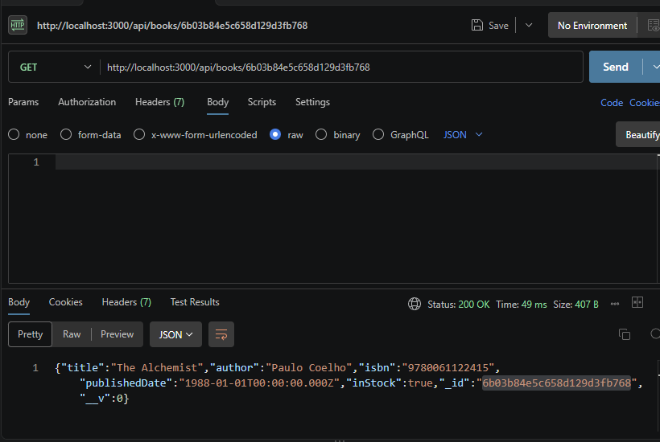

<br>

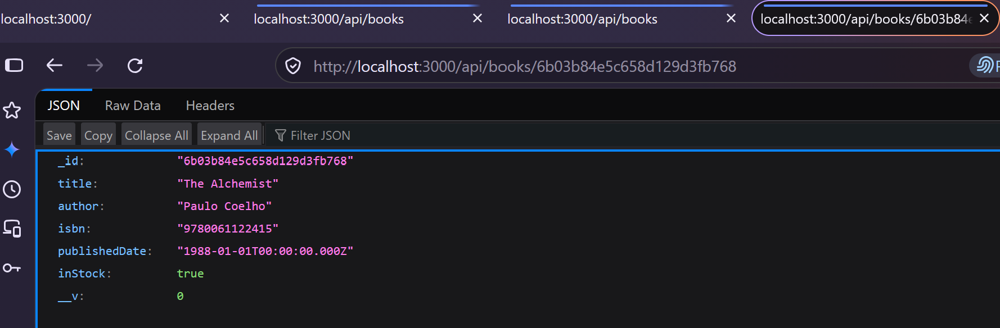

<br>

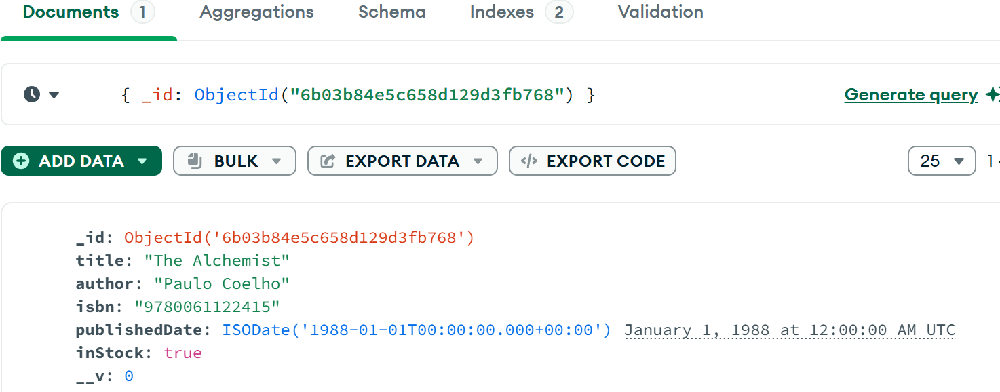

**8. Get Book by ID — Not Found (`GET /api/books/:id`)

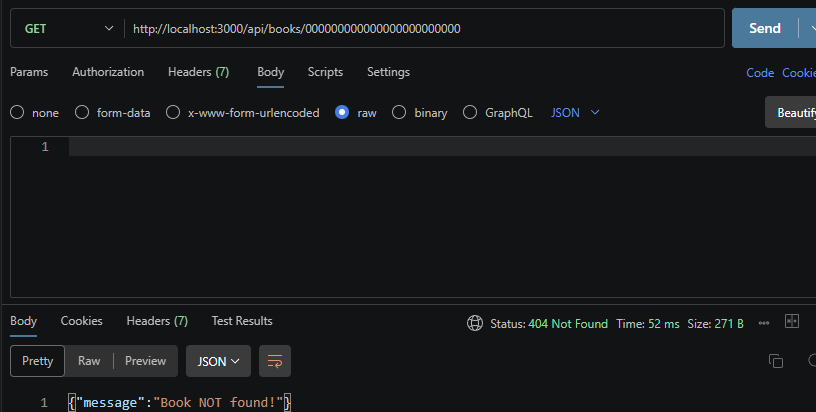

<br>

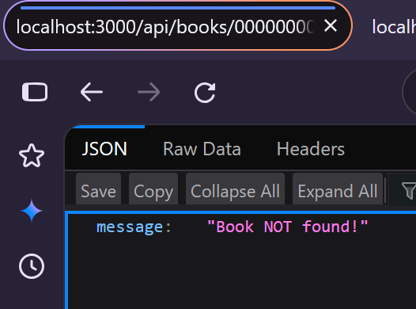

<br>

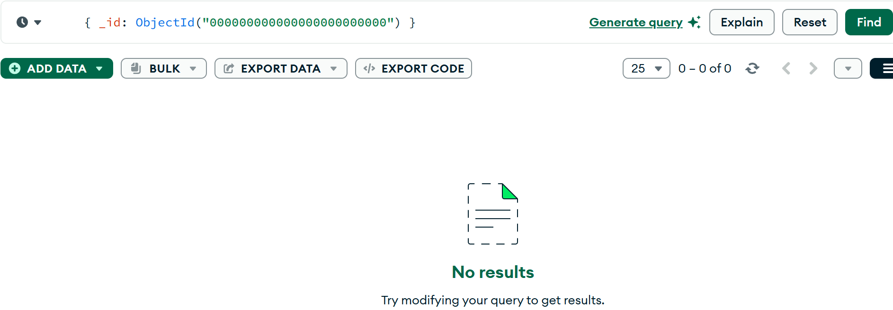


**9. Update a Book (`PUT /api/books/:id`)**

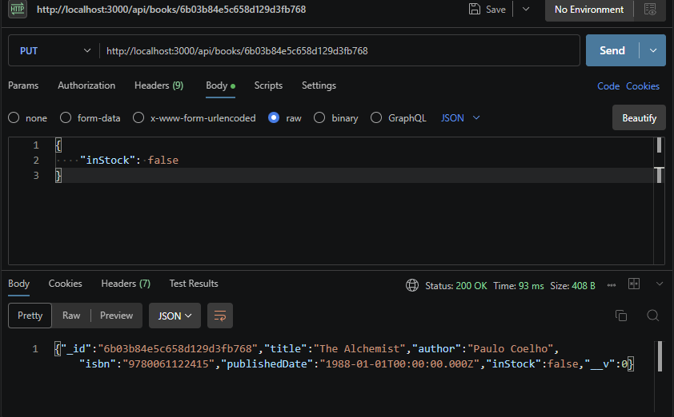

<br>

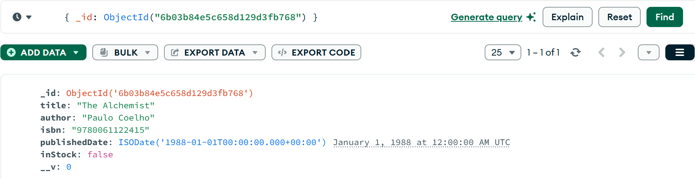

<br>

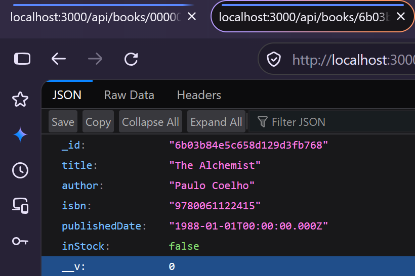

**10.  Delete a Book (`DELETE /api/books/:id`)

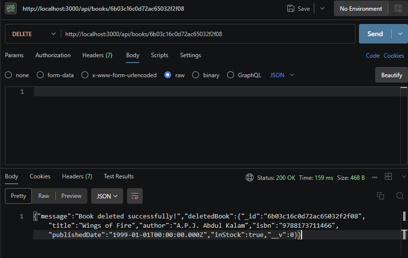

<br>

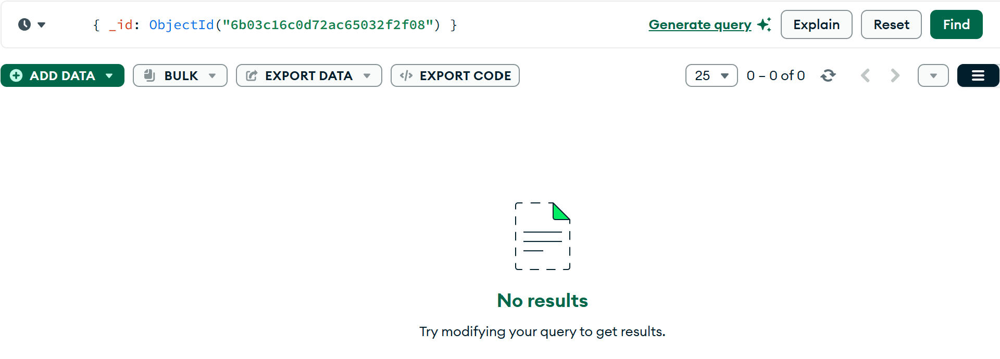

<br>

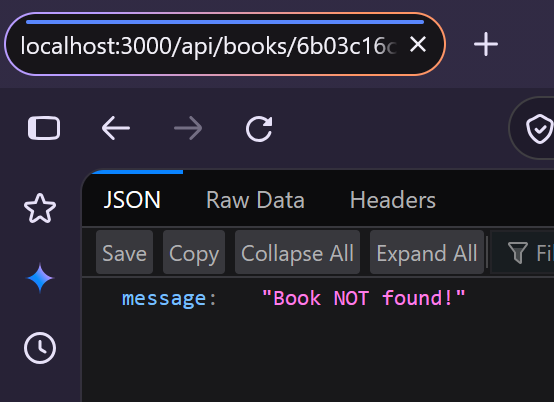

## 9. Challenges Faced and How I Addressed Them

**1. Connecting to MongoDB Atlas**

Initially, I had some difficulty understanding how to connect MongoDB Compass to the cloud database. I also noticed that my data was being stored in the default `test` database.

I learned that specifying a database name in the MongoDB connection string helps direct the application to the intended database. I updated the connection string to use `digital-bookshelf`.

**2. Understanding API Requests and Request Data**

I learned the difference between `req.body` and `req.params.id`.

- `req.body` contains the data sent by the client.
- `req.params.id` contains the book ID provided in the URL.

Understanding this helped me implement the create, update, and delete operations.

**3. Testing PUT and DELETE Operations**

I initially understood how to retrieve data through the browser but wanted to know whether I could perform update and delete operations directly through the browser or MongoDB Compass.

I learned that Postman can send PUT and DELETE requests to test my API. MongoDB Compass can also edit or delete documents directly, but doing so bypasses the API routes. I used Postman to test the actual API functionality and Compass to verify the database changes.

**4. Mongoose Deprecation Warning**

While testing the PUT operation, I encountered a Mongoose deprecation warning for the `new` option in `findByIdAndUpdate()`.

I learned that the recommended option is now `returnDocument: 'after'`.

I changed the update options to:

```javascript
{
    returnDocument: 'after',
    runValidators: true
}
```

The `returnDocument: 'after'` option returns the updated document, while `runValidators: true` ensures that schema validation is applied to the updated fields.

This helped me understand the importance of checking library warnings and keeping code compatible with newer versions.

**5. Understanding Error Responses**

I also tested what happens when a book ID does not exist. The API returned a 404 response with a "Book not found" message.

This helped me understand why checking whether a database query returned a document is important before sending a success response.

## 10. What I Learned

Through this project, I learned:

- How to create a backend server using Express.js.
- How to connect an application to MongoDB Atlas using Mongoose.
- How to create schemas and models to define the structure of database documents.
- How to organize an application using separate folders for database connections, models, and routes.
- How REST API endpoints work and how HTTP methods are used for CRUD operations.
- How to use `async/await` and `try/catch` to handle asynchronous database operations and errors.
- How middleware such as `express.json()` processes incoming JSON request data.
- How to use Postman to test different HTTP methods.
- How to verify database records using MongoDB Compass.
- How to use appropriate HTTP status codes for successful requests and errors.

## 11. Future Improvements

Some features I would like to explore and add in the future are:

- Add search functionality to find books by title or author.
- Add pagination to handle larger collections of books.
- Implement filtering based on author or availability.
- Add user authentication so that only authorized users can manage books.
- Improve input validation and provide more descriptive error messages.
- Build a frontend application that allows users to manage books through a user interface instead of sending requests manually through Postman.

## 12. Running the Project Locally

1. Clone the repository.
2. Install the dependencies:

```bash
npm install
```

3. Create a `.env` file in the project root and add your MongoDB connection string:

```env
MONGO_URI=your_mongodb_connection_string
```

4. Start the server:

```bash
node index.js
```

5. Open the following URL in your browser:

`http://localhost:3000/`

The server should display a message confirming that it is running.

**Important:** The `.env` file contains database credentials and should not be uploaded to GitHub. It is included in `.gitignore`.